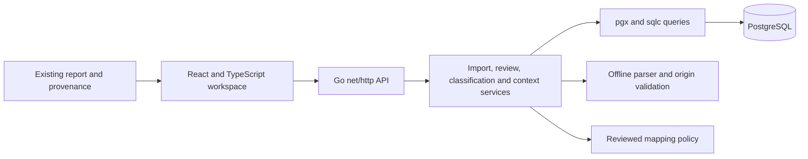

# Implemented system design

Baseline `f1613e6fd5d64625dc239d2673cb019ecb964efd`. This is a local single-operator evidence workspace. The implemented workflow goes from an existing ZAP Traditional JSON report through PostgreSQL to finding inspection, human review, classification and context history. [Frontend guide](../../frontend/FRONTEND.md) · [Backend guide](../../backend/BACKEND.md)

## Components and boundaries

| Component | Implemented responsibility |
| --- | --- |
| Browser | Unlock with an operator token held in memory. Register a server-defined target, upload a file, show report provenance and evidence, and page and filter findings. Separate severity, verification, OWASP mapping and absent CVSS values. Edit and inspect history and context through typed requests. [Router](../../frontend/src/app/main.tsx) · [Evidence screens](../../frontend/src/features/evidence.tsx) · [API client](../../frontend/src/api/client.ts) |
| HTTP API | Same-origin `/api/v1` boundary with bearer authentication, bounded input, structured problems and request IDs. API DTOs describe evidence and revisions without exposing generated persistence structs. [HTTP routes](../../backend/internal/httpapi/api.go) · [OpenAPI 3.1 contract](../../contracts/openapi.yaml) |
| Application service | Validate target scope and evidence references. Manage transactions, optimistic predecessor checks under database locks, and audit events. Apply reviewed mapping rules and resolve context on reads. [Import service](../../backend/internal/service/service.go) · [Review service](../../backend/internal/service/reviews.go) · [Classification service](../../backend/internal/service/classifications.go) · [Context service](../../backend/internal/service/contexts.go) |
| Storage | Typed SQL compiled with sqlc, pgx connections and goose migrations, using separate migration and runtime privileges. [Database setup](../../backend/db/sqlc.yaml) · [Store](../../backend/internal/store/store.go) · [Migrations](../../backend/db/migrations) |

## Evidence flow

The import takes exact uploaded bytes and optional provenance. It hashes the submitted file and checks the report envelope, bounded sizes, each site origin and each instance URL before persisting the normalized run. Report URLs stay offline data. The normalization retains each instance as a source observation with a JSON pointer and scanner fields. Unlocated alerts are retained at report level. Reads expose redacted excerpts and a separately acknowledged, audited raw download of the submitted bytes. For the genuine fixture, the submitted bytes are the reviewed derivative. The untouched lab export is a distinct private artifact. [Parser](../../backend/internal/zap/parser.go) · [URL policy](../../backend/internal/scope/url.go) · [Fixture provenance](../fixture-provenance.md)

The v1 finding fingerprint groups observations by target, scanner, plugin, uppercase method, canonical origin, normalized path, sorted unique query names and parameter. It excludes query values and attack/evidence text. Import identity is target + submitted digest + parser version. Exact duplicates reuse the existing run, and a conflicting provenance submission receives 409. One transaction persists evidence, observations, applicable automatic mappings and audit changes. Group membership is evidence organization. Root-cause identity requires separate review. [Import SQL](../../backend/db/queries/imports.sql) · [Provenance decision](../decisions/0001-immutable-import-provenance.md)

## Data model and revisions

| Records | Identity and relationships |
| --- | --- |
| Targets, report imports, findings and observations | A target represents one canonical origin. It has many import runs and grouped findings. Each observation belongs to one matching-target import and finding. Unique import/pointer and fingerprint constraints enforce stable identities. [Initial migration](../../backend/db/migrations/00001_imports.sql) |
| Verification and classification revisions | Each append references a finding and validated observations. Review states include unreviewed, confirmed, false positive and inconclusive. Automatic classification uses the reviewed versioned plugin/CWE policy, records ambiguity and retains history. An operator revision supersedes the automatic head without changing scanner severity or verification. [Verification migration](../../backend/db/migrations/00005_verification.sql) · [Classification migration](../../backend/db/migrations/00006_classification.sql) |
| Context revisions | Four factor values and supporting provenance are appended per target default or exact method/path. Resolution chooses the latest exact match, then latest default, then unknown factors when no revision applies. The selected revision retains explicit unknown values. History stays immutable and resolution supplies the source revision. [Context migration](../../backend/db/migrations/00007_context.sql) · [Resolution SQL](../../backend/db/queries/contexts.sql) |
| Audit events | Store event identity, request ID, actor, action and entity reference with redacted metadata. Accepted revisions and mutations are audited in their transaction. [Initial migration](../../backend/db/migrations/00001_imports.sql) |

## API boundary in use

Health and readiness are public local probes. The protected groups cover target registration and list/detail, multipart import, import details and private download, filtered findings and observations, review/classification history and append, target context history and append, and resolved finding context. History cursors scope their sort position to the listing. Stale predecessors receive HTTP 409 and leave existing revisions intact. The frontend keeps the pending context draft on its current scope during conflict recovery. [OpenAPI contract](../../contracts/openapi.yaml) · [Implementation evidence](implementation-evidence.md)

The current API has no scoring, ranking, export or scan orchestration endpoint. Base and contextual score slots are null. M3–M6 are planned and the comparative research hypothesis remains unevaluated. [Proposed protocol](../research-protocol.md)
